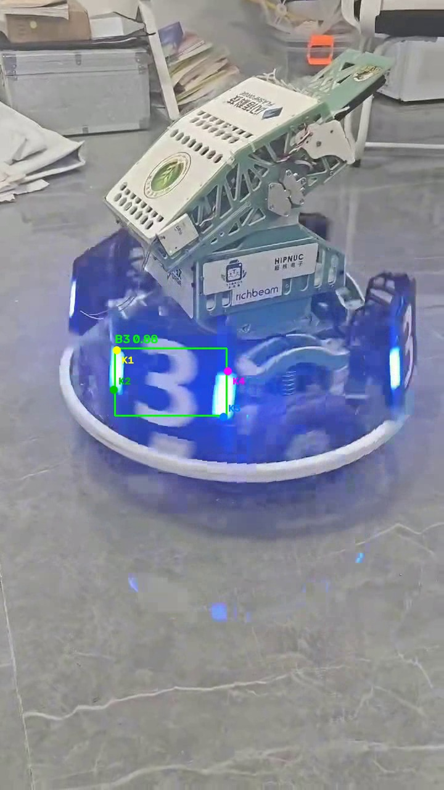

# YOLO26n 装甲板视频推理

使用课程提供的 YOLO26n Pose 权重，对自行拍摄的装甲板视频逐帧推理，并保存带标注的 MP4。每个检测目标显示检测框、类别、置信度，以及模型预测的四个关键点 K1–K4。模型类别为 B1、B2、B3、R1、R2、R3。

## 环境

- Windows，Python 3.12；CPU 可以运行，GPU 可选。
- 主要依赖见 `requirements.txt`：Ultralytics 8.4.174、OpenCV 5.0.0.93。安装 Ultralytics 时会一并安装 PyTorch。
- 本项目只做推理，不需要重新训练，也不需要同济大学 `sp_vision_25` 的 C++ 编译依赖。

在 PowerShell 中进入仓库目录后执行：

```powershell
python -m venv .venv
.\.venv\Scripts\python.exe -m pip install -r requirements.txt
.\.venv\Scripts\python.exe -c "import torch, ultralytics, cv2; print(torch.__version__, ultralytics.__version__, cv2.__version__, torch.cuda.is_available())"
```

如果创建虚拟环境时遇到临时目录 `PermissionError`，先将 `TEMP` 和 `TMP` 指向有写权限的目录，再运行 `ensurepip`：

```powershell
New-Item -ItemType Directory -Force .\temp | Out-Null
$env:TEMP = (Resolve-Path .\temp).Path
$env:TMP = $env:TEMP
.\.venv\Scripts\python.exe -m ensurepip --upgrade --default-pip
```

## 准备权重和视频

从课程参考材料下载 `best.pt`。本项目使用约 5.9 MB 的 YOLO26n Pose 权重，不要选约 126 MB 的教师模型。也可从训练结果压缩包的 `weights/best.pt` 提取。把权重和本人拍摄的原始视频放在仓库外，或放进本地 `videos/`；这些文件不提交到 Git。示例视频为约 17 秒的蓝色 3 号机器人装甲板，竖屏拍摄。

## 运行

```powershell
.\.venv\Scripts\python.exe infer.py --model "G:\best (2).pt" --input "G:\Tencent Files\1030504119\nt_qq\nt_data\Video\2026-10\Ori\7aa2aefaa2773c34d1be263e8ce1e9e8.mp4" --output "outputs\armor_result.mp4" --device cpu
```

可用 `--model`、`--input`、`--output` 更改路径，`--conf` 更改检测阈值（默认 0.25），`--imgsz` 更改推理尺寸（默认 640）。若已安装支持 CUDA 的 PyTorch 且 `torch.cuda.is_available()` 返回 `True`，可将 `--device cpu` 改为 `--device 0`。

运行完成后打开 `outputs/armor_result.mp4`，检查画面、时长、检测框、类别、置信度和四个关键点。视频无法打开时，先确认输入路径和本机 MP4 编解码支持；脚本会在输出文件无法创建时直接报错。

## 实现与结果记录

`infer.py` 使用 OpenCV 读取和写入视频，Ultralytics 加载权重并推理。检测框来自 `result.boxes.xyxy`，类别与置信度来自 `boxes.cls` 和 `boxes.conf`，四个关键点来自 `result.keypoints.xy`，不是检测框的四个角。没有检测到目标的帧仍会写入输出视频。

本地 CPU 实测：输入为 720 × 1280、约 17 秒的视频，共 515 帧；输出 MP4 仍为 515 帧，文件可正常读取。394 帧出现检测，累计 445 个检测结果。部分转向或遮挡画面没有检测结果；这类帧仍保留在视频里。示例画面如下，类别为模型给出的 B3，四个彩色点是模型预测的关键点。



对漏检、误检或关键点偏移应保留真实结果，不手工伪造预测。

## 提交说明

推理代码、依赖说明和本文档通过开发分支 PR 合并到 `main`。原始视频与结果视频作为课程作业附件提交；权重、视频、虚拟环境和输出目录由 `.gitignore` 排除。
